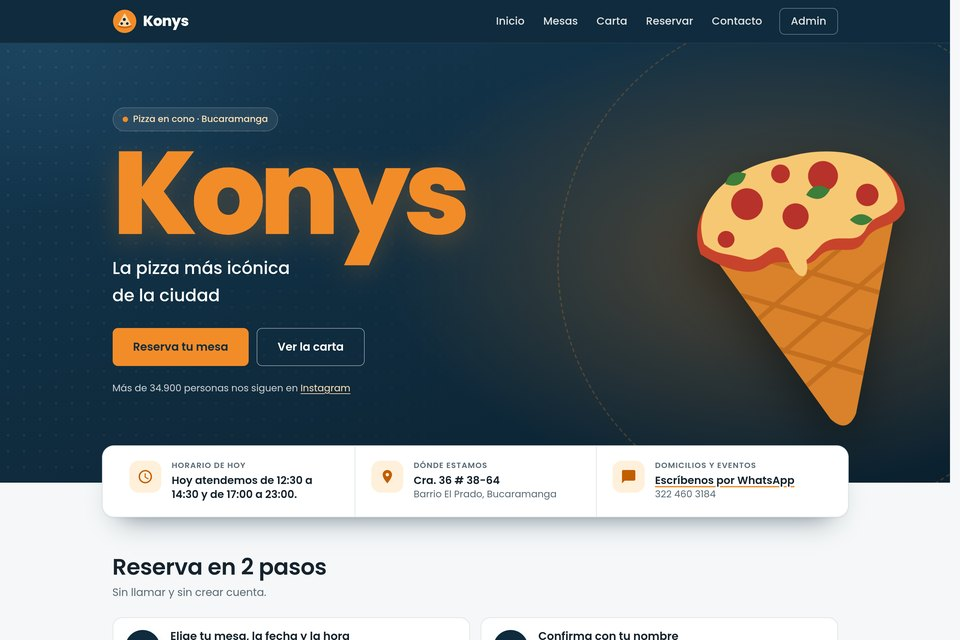
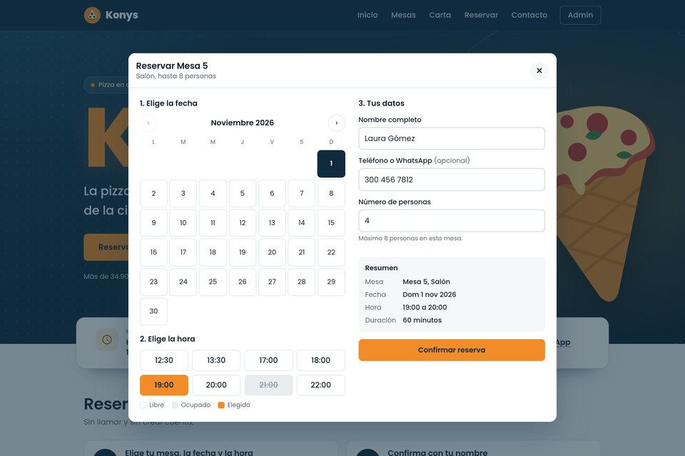
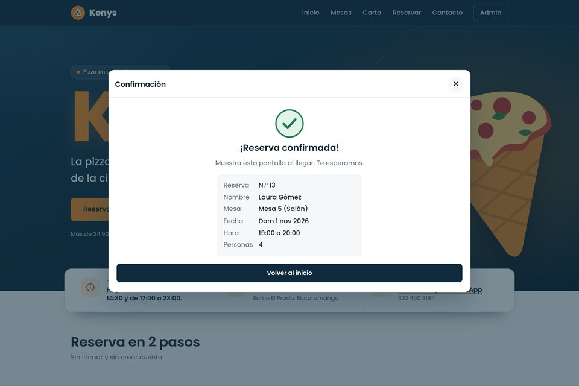
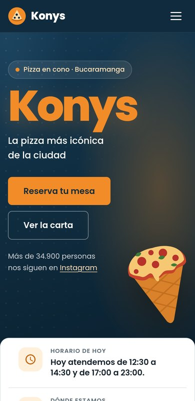
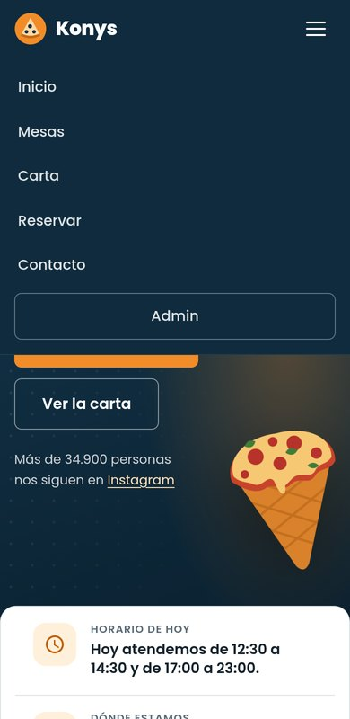
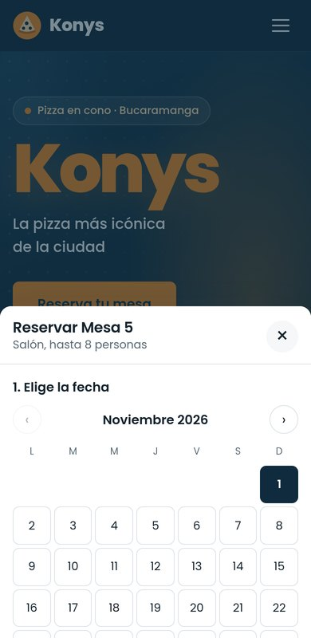
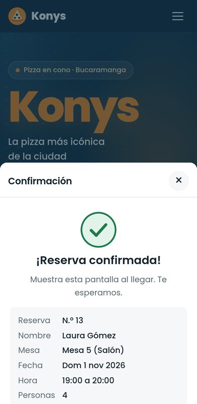
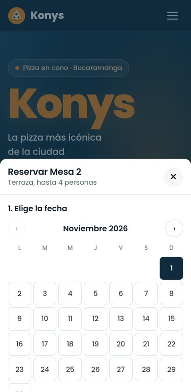
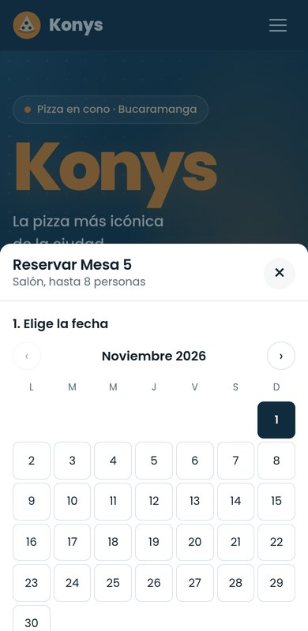
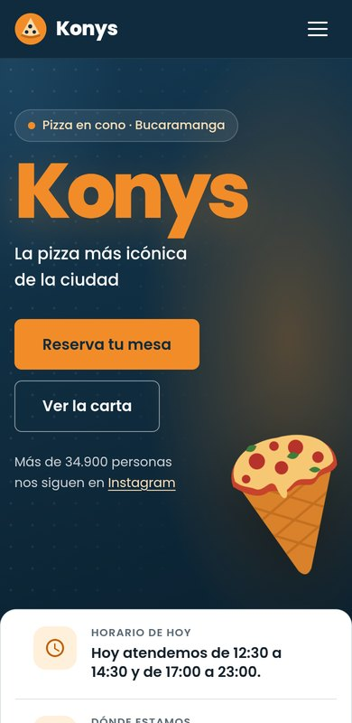

# Konys Reservas

Aplicación web para reservar mesas en **Konys Pizza** (Cra. 36 # 38-64, barrio El Prado, Bucaramanga).

Antes, las reservas se hacían por llamada, WhatsApp o en persona, y eso causaba mesas reservadas dos veces y clientes que no sabían qué había libre. Con esta app el cliente ve las mesas, elige fecha y hora, y confirma su reserva sin llamar. El administrador maneja las mesas, los horarios, las reservas y la carta desde un panel.

- **App desplegada:** <https://konys-pizza.vercel.app>
- **Panel de administración:** <https://konys-pizza.vercel.app/admin>
- **Video explicativo:** _(pega aquí el enlace de YouTube o Drive)_

## Qué hace

**Cliente (sin cuenta)**
- Ve todas las mesas activas con su zona, capacidad y estado de hoy.
- Elige una mesa, una fecha (solo días con horario, hasta 30 días) y un horario libre.
- Escribe su nombre, el número de personas y, si quiere, un teléfono.
- Ve una confirmación con los datos de su reserva.
- Consulta la carta por categorías: pizzas, entradas, postres y bebidas.

**Administrador (en `/admin`, con correo y contraseña)**
- Registra, edita, borra y activa o desactiva mesas.
- Cambia el horario de cada día (almuerzo y noche) y la duración de cada reserva.
- Ve todas las reservas, las filtra por fecha o mesa y les cambia el estado.
- Agrega, edita, oculta y borra platos de la carta.

La app no deja hacer dos reservas en la misma mesa a la misma hora. Lo revisa el navegador antes de guardar y también la base de datos, así que funciona aunque dos personas confirmen al mismo tiempo.

## Mockups

Diseño de las pantallas del cliente. Cada imagen es una vista previa; al hacer clic se abre completa (los archivos están en [`docs/mockup/cliente/`](docs/mockup/cliente/)).

**Escritorio**

| Inicio | Reservar | Confirmación |
|:---:|:---:|:---:|
| <a href="docs/mockup/cliente/escritorio-inicio.png"></a> | <a href="docs/mockup/cliente/escritorio-reservar.png"></a> | <a href="docs/mockup/cliente/escritorio-confirmacion.png"></a> |

**Celular**

| Inicio | Menú | Reservar | Confirmación |
|:---:|:---:|:---:|:---:|
| <a href="docs/mockup/cliente/movil-inicio.png"></a> | <a href="docs/mockup/cliente/movil-menu.png"></a> | <a href="docs/mockup/cliente/movil-reservar.png"></a> | <a href="docs/mockup/cliente/movil-confirmacion.png"></a> |

**Estados de la pantalla**

| Cargando | Sin cupo ese día | Error de formulario | Lista vacía |
|:---:|:---:|:---:|:---:|
| <a href="docs/mockup/cliente/estado-cargando.png"></a> | <a href="docs/mockup/cliente/estado-sin-cupo.png"></a> | <a href="docs/mockup/cliente/estado-error-formulario.png"></a> | <a href="docs/mockup/cliente/estado-lista-vacia.png"></a> |

## Tecnologías

| Tecnología | Para qué se usa |
|---|---|
| HTML5 | Estructura de las páginas (`index.html` y `admin.html`) |
| CSS3 | Diseño y versión para celular, con Flexbox y Grid (`css/styles.css`) |
| JavaScript (ES6+) | Lógica de la app, sin frameworks (`js/`) |
| Supabase | Base de datos PostgreSQL, reglas de seguridad (RLS) e inicio de sesión del admin |
| GitHub | Control de versiones |
| Vercel | Despliegue automático en cada `git push` |

## Estructura

```
konys-reservas-app/
├── index.html              # Página del cliente
├── admin.html              # Panel de administración
├── css/styles.css          # Estilos de las dos páginas
├── js/
│   ├── supabase.js         # Conexión con Supabase y consultas
│   ├── cliente.js          # Lógica de la página del cliente
│   ├── admin.js            # Lógica del panel
│   ├── logica.js           # Funciones de slots, fechas y validaciones
│   ├── ui.js               # Ventanas (modales) y avisos
│   └── config.example.js   # Ejemplo de configuración (las claves no se suben)
├── img/                    # Logo e ilustraciones
├── supabase/
│   ├── schema.sql          # Tablas, seguridad y funciones
│   ├── datos-ejemplo.sql   # Mesas, carta y reservas de prueba
│   └── migraciones/        # Cambios para una base ya creada (001-seguridad.sql)
├── scripts/
│   ├── generar-config.js   # Crea js/config.js con las variables de entorno
│   └── construir.js        # Arma dist/ con solo lo que se publica en Vercel
├── tests/                  # Pruebas de la lógica y de la base de datos
├── docs/                   # Documento del proyecto, mockups y guía
├── vercel.json
└── package.json
```

## Cómo ejecutarlo

Necesitas [Node.js](https://nodejs.org) 18 o superior y un proyecto gratuito en [Supabase](https://supabase.com).

1. **Base de datos.** En Supabase abre *SQL Editor*, pega todo `supabase/schema.sql` y ejecútalo. Después haz lo mismo con `supabase/datos-ejemplo.sql` si quieres datos de prueba.
2. **Usuario administrador.** En *Authentication > Users* crea un usuario con correo y contraseña (marca que quede confirmado). Luego, en el SQL Editor, ejecuta:
   ```sql
   insert into public.administradores (email) values ('tu-correo@gmail.com');
   ```
3. **Claves.** Copia `js/config.example.js` como `js/config.js` y pega la *Project URL* y la clave pública (*anon* o *publishable*) de tu proyecto. Nunca uses la clave *service_role* o *secret*.
4. **Abrir la app.** En la carpeta del proyecto ejecuta:
   ```bash
   npm run dev
   ```
   y entra a <http://localhost:5500>. El panel está en <http://localhost:5500/admin>.
   (Abrir `index.html` con doble clic no funciona, porque los módulos de JavaScript necesitan un servidor.)

### Despliegue en Vercel

1. Importa el repositorio de GitHub en Vercel.
2. En *Environment Variables* agrega `SUPABASE_URL` y `SUPABASE_ANON_KEY`.
3. Dale *Deploy*. `vercel.json` ejecuta `scripts/construir.js`, que arma la carpeta `dist/` con solo las páginas, estilos, scripts e imágenes (nunca el SQL ni las pruebas) y crea `js/config.js` con esas variables, así que las claves nunca quedan en el código.

### Pruebas

```bash
npm test                  # lógica de slots, fechas y validaciones
bash tests/db/correr.sh   # reglas de la base de datos (necesita PostgreSQL instalado)
```

## Seguridad

La app se revisó con pruebas de ataque, validación en el servidor, permisos mínimos en la base de datos, límite de reservas por IP y cabeceras de seguridad (CSP). El informe completo está en [`docs/SEGURIDAD.md`](docs/SEGURIDAD.md).

## Créditos

Proyecto académico de Ingeniería de Software, Universidad de Santander (UDES).
Hecho por Eder Rosadas De Oliveira Barrera.
Konys Pizza es un negocio real de Bucaramanga. La carta de `datos-ejemplo.sql` sale de lo que publican en Rappi (precios de referencia de octubre de 2026); las mesas y reservas son de prueba.
